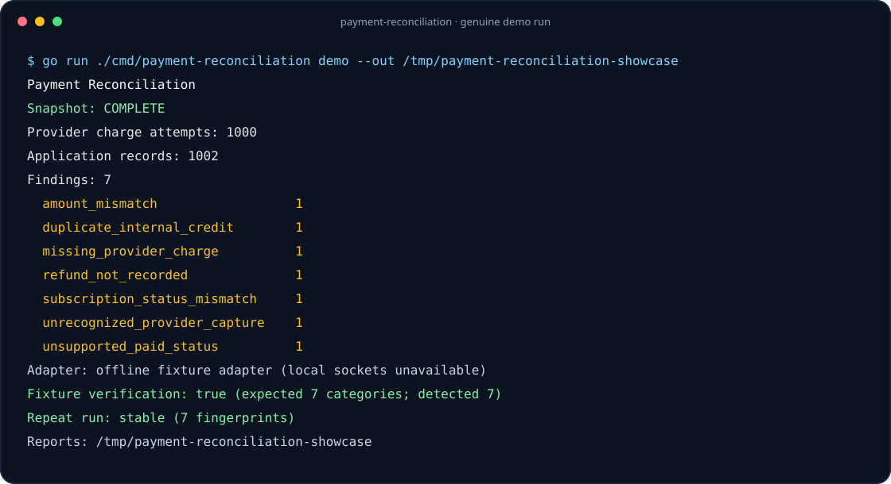

# Payment Reconciliation

Compare application payment records with provider records to find mismatches, missing charges, duplicate credits, and other reconciliation issues. The Go CLI produces JSON, CSV, and HTML reports without changing financial data.



The demo processes 1,000 provider charge attempts against 1,002 application records. It checks the resulting findings against an independent fixture manifest and repeats evaluation to verify stable fingerprints. The screenshot shows captured output from an actual run; this environment did not permit loopback TCP, so the command selected its documented offline fixture adapter.

## Features

- Account-scoped payment matching using exact provider references.
- Evidence-backed findings for amount and status mismatches, missing or unrecognized charges, duplicate internal credits, refunds, and subscriptions.
- Incomplete-snapshot safeguards that avoid definitive missing-record findings when provider collection is incomplete.
- A deterministic provider simulator with authenticated, paginated HTTP endpoints.
- JSON, CSV, and HTML reports, plus a small local report dashboard and review-action audit log.
- Integer minor-unit money values and stable finding fingerprints.

## Quick start

Requires Go 1.23 or newer. The local demo needs no external credentials or services.

```sh
go test ./...
make demo
```

The demo writes `artifacts/demo/report.json`, `report.csv`, `report.html`, and `verification.json`. It normally collects provider records from the HTTP simulator over loopback; if local sockets are unavailable, it reports that and uses its offline fixture adapter. To keep generated reports elsewhere, run `go run ./cmd/payment-reconciliation demo --out /tmp/reconciliation-demo`.

## Run the report dashboard

After generating a report, start the local report dashboard:

```sh
make serve
```

Open [http://127.0.0.1:8080](http://127.0.0.1:8080). The page shows coverage and findings, supports a high-severity filter, and links to the JSON report. The service also exposes `/healthz`, `/api/summary`, `/api/findings`, `/api/runs`, and `/api/reports/latest.json`. Review actions are available through `POST /api/findings/{fingerprint}/review` with an `acknowledged`, `investigating`, or `resolved` status and a required note. They append to a local JSONL audit log.

To use another address or report file, set `HTTP_ADDR` or `REPORT_PATH`. See [.env.example](.env.example) for the local settings reference.

## Run the provider simulator

The simulator requires a bearer key for the demo account:

```sh
export PROVIDER_API_KEY="$(openssl rand -hex 32)"
make provider-sim
```

In another terminal, check its health and fetch a page of charges:

```sh
curl http://127.0.0.1:8081/healthz
curl -H "Authorization: Bearer $PROVIDER_API_KEY" \
  'http://127.0.0.1:8081/v1/charges?account_id=acct-demo&page=1&page_size=100'
```

The simulator also provides `/v1/refunds` and `/v1/subscriptions`, with collection and individual-record routes, account scoping, deterministic ordering, and pagination up to 500 records per page. Configure its listen address with `PROVIDER_ADDR`.

## Reports and finding rules

The demo fixture exercises a failed provider attempt, an amount mismatch, a missing provider charge, a duplicate internal credit, an unrecognized capture, an account-scoped reference collision, an unrecorded refund, and a stale subscription status. `fixtures/demo/expected.json` is the expected category manifest. The generated verification report records expected and detected counts.

See [the reconciliation rules](docs/reconciliation-rules.md), [report schema](docs/report-schema.md), and [demo details](docs/demo.md) for more. Additional evidence:

| Demonstration                                 | What it shows                                                          |
| --------------------------------------------- | ---------------------------------------------------------------------- |
| [CLI overview](docs/screenshots/overview.svg) | Real demo output, verification counts, and stable finding fingerprints |

## Architecture and limitations

`internal/provider` owns provider-side fixture records and HTTP endpoints. `internal/reconcile` contains typed records and pure evaluation logic, with no HTTP or persistence dependency. The command collects a normalized provider snapshot, evaluates it against application records, and writes reports. Read more in [the architecture overview](docs/architecture.md).

This is a local prototype. The provider simulator is in-memory and resets on restart; PostgreSQL persistence, migrations, historical run storage, and a production multi-user security model are not implemented. The dashboard and review endpoint are intended for a trusted loopback operator, not exposure to an untrusted network. Findings do not establish bank settlement, payout completion, or general-ledger correctness.

## Development

```sh
make test       # unit and handler tests
make race       # race detector
make build      # compile the CLI
make demo       # generate and verify demonstration reports
```

See [CONTRIBUTING.md](CONTRIBUTING.md) for contribution guidance.


## License & Custom Work

[](mailto:work@withrana.com) [](https://www.linkedin.com/in/workwithrana)
[](https://www.upwork.com/freelancers/~01bbcf6edb91a8df5f)
[](https://contra.com/ranajahanzaib/)

**License:** MIT, see [LICENSE](LICENSE). Free for personal and commercial use.

**Author:** Rana Jahanzaib

**Need this built for your stack?** Email me what you're working on: work@withrana.com
